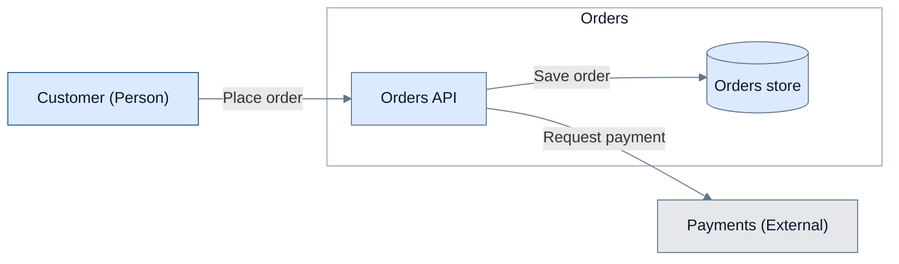

# One source, derived renderings

Read the existing [Architecture Markdown v1 schema](../../architecture-to-lucid/references/markdown-format.md) before editing architecture records. Start from its [single template](../../architecture-to-lucid/assets/architecture-model-template.md); do not copy the schema or invent an interview-specific format.

## Interview update cycle

1. Resolve the owning model path/revision from `interview/state.md`: `high-level-design/architecture-model.md` for C1/C2, `low-level-design/architecture-model.md` for C3 and detailed sequences. Apply the shared schema’s context-reference rule before validating each file independently. For Existing Design, record the source-to-output mapping without moving or rewriting sources; normalize nonconforming input only once and reuse conforming input directly. Follow the [intake guidance](workflow.md#existing-design-intake) before rendering.
2. Write supported answers/proposals into the canonical tables or sequence sections. Cite brief/specification locators or persisted interview decisions in Sources. Use Proposed for inferences, Open for unresolved choices, Confirmed only with evidence. Interview/review progress is not evidence by itself. Record material gaps under Open questions, with affected IDs.
3. Validate with the existing helper, resolving its path from the sibling skill:
   ```bash
   python3 ../architecture-to-lucid/scripts/validate_markdown.py /project/specifications/low-level-design/architecture-model.md
   ```
   The command above assumes this skill's directory as the working directory; otherwise resolve an absolute helper path. Python 3.9+, standard library only. Use `--json` only when useful for rendering; generated JSON is disposable and never edited as input. If unavailable, check manually and report that limit.
4. Render useful affected views/scenarios into the appropriate HLD/LLD design document (or a useful component specification). Label every Mermaid block as derived and identify its canonical file, view/sequence ID and revision (commit when available, otherwise a checkpoint revision). Keep the checkpoint small: paths, IDs, revision and pending refreshes, not copies of tables or markup.
5. Discuss the preview with the architect. Apply requested semantic changes to canonical Markdown first, validate and regenerate. Never recover architecture from a stale preview when canonical records exist.

A newly copied blank template is intentionally incomplete. During initial discovery, keep unresolved validation errors explicit in the checkpoint; do not invent records to pass. Only claim a preview is validated when its canonical input passes. No Lucid publication from structurally invalid input. Regeneration is an agent workflow, not a background synchronization service.

## Structure to Mermaid

Read the selected Views row and resolve its Elements and Relationships against canonical tables. Apply [Readable Mermaid](../SKILL.md#readable-mermaid): each focused rendering may show a subset of that view's elements and relationships; identify the included canonical IDs and explain its scope beside the diagram. Preserve directions and meaning; shorten Action labels faithfully and keep full wording and Details accessible through adjacent canonical references. Do not invent inferred aggregate edges: C1 and C2 use their own declared relationship IDs.

Use a compact Mermaid flowchart with global element IDs as node IDs and relationship IDs in an adjacent derivation comment if the renderer cannot attach them to edges. Keep node labels short, using Name and only essential Type or technology hints; reference Responsibility and other details in the canonical model. Escape labels for Mermaid without changing meaning. Use actor/store visual roles when supported; indicate any visual approximation. At C2/C3 draw the Focus as a boundary and place its visible direct children inside; keep contextual elements outside. Do not also draw Focus as an inner node. Ownership comes from Scope/Parent, not placement.

After generation compare the included node/edge subset, endpoints, label meaning, ownership and boundary membership with the canonical view; keep omitted information in the complete canonical model. Mermaid is a discussion preview; visual styling need not reproduce Lucid's layout.

## Mermaid Clean / Minimal

Apply this visual convention to Mermaid in `design-doc.md`, alongside [Readable Mermaid](../SKILL.md#readable-mermaid). It adapts the ownership palette and compact labels from the Lucid [rendering conventions](../../architecture-to-lucid/SKILL.md#rendering-and-verification) and [workflow defaults](../../architecture-to-lucid/references/lucid-workflow.md#create-selected-views); it does not reuse Lucid import configuration or require Lucid rendering.

- **Palette and roles:** internal elements use pale blue `#DBEAFE`, external systems light gray `#E5E7EB`, and text dark slate `#0F172A`. Use `#155A91` as the actor accent, with pale blue fill for readable labels. Keep borders thin and muted; use a white or neutral boundary with a short title. Blue means internal ownership even outside the current focus boundary. Do not encode status or importance through extra colors; explain these in adjacent prose.
- **Hierarchy and labels:** let the diagram title and focus boundary establish hierarchy. Use the canonical Name, shortened faithfully only when needed, and at most one essential type/technology hint. Keep relationship labels as short English actions, normally 2–3 words, with full details in the model. Avoid decorative icons, gradients, shadows and repeated descriptions. Use a cylinder for stores; a labeled rectangle is an acceptable actor approximation in portable flowcharts, disclosed beside the preview.
- **Grouping and orientation:** group by canonical boundaries using `subgraph`, not decorative boxes. Keep context outside the focus and avoid deep nesting. Prefer `LR` for interaction paths and `TB` for layers or a narrow document; choose the direction that fits the target reading width. Do not depend on a subgraph's local direction: links to outside nodes can override it. Reduce crossings by simplifying the focused projection, without changing edge direction or inventing routing nodes.
- **Relations and reusable styles:** use simple directed connectors with consistent weight; reserve dashed lines for a declared meaning and explain it. Use named `classDef` roles and `class` assignments for flowchart nodes, a small `style` for the boundary, and `linkStyle default` for neutral connectors. Reuse these role styles across derived blocks; keep the maintained example here rather than adding a per-project theme file. Color complements labels and shapes; it must not be the only role cue.
- **Other Mermaid types:** flowchart classes do not apply to sequences or state diagrams. Keep their native notation, short labels and restrained grouping; use the host's supported neutral theme rather than injecting flowchart CSS. Sequence participant order, message semantics, branches and activation take precedence over visual uniformity.
- **Compatibility and review:** use documented [flowchart syntax](https://mermaid.js.org/syntax/flowchart.html) supported by the target renderer. Do not require `%%{init}%%` directives, custom CSS/fonts, HTML labels, icon packs, new shape syntax or a particular layout engine. If styling is unsupported, keep the readable native diagram and disclose the approximation. Inspect the rendered preview at the document's reading width for contrast, clipping, crossings and overlap; syntax validation alone does not establish visual quality. Report when rendering could not be checked.

### Reusable flowchart example

Illustrative C2 projection only; replace IDs, labels and membership from the selected canonical view. Keep its source path, view ID, revision and included element/relationship IDs beside the derived block as described above. Here `customer` is a rectangle approximation of a Person; `payments` is external and `orders` is the focus boundary.



## Canonical sequence to Mermaid

Read the selected canonical PlantUML block and metadata, never another diagram. For a crowded sequence, use clearly scoped excerpts with canonical references and a short explanation of each excerpt. Within each excerpt, preserve participant order and IDs, message order, endpoints, group nesting, notes and activation; shorten display names and message text only without changing meaning, with full wording accessible in the canonical source. Map supported semantics using the [official Mermaid sequence syntax](https://mermaid.js.org/syntax/sequenceDiagram.html) for the available renderer:

| Canonical PlantUML | Derived Mermaid |
|---|---|
| actor | actor |
| participant, boundary, control, entity, database | typed participant when supported; otherwise participant with the original role in adjacent preview notes |
| `->` / `-->` | `->>` / `-->>` (solid/dashed synchronous/return arrows) |
| `->>` / `-->>` | `-)` / `--)` (solid/dashed asynchronous arrows) |
| alt / else / loop / opt / par / critical | corresponding sequence group and matching end |
| group | rect with the original group label in an adjacent note |
| notes / activate / deactivate / autonumber | corresponding Mermaid constructs when supported |

Do not turn an asynchronous call into a synchronous call or flatten branches to obtain a renderable preview. If the available Mermaid version cannot represent a construct faithfully, disclose the exact limitation and omit that preview (or show a clearly identified partial excerpt); retain the complete canonical PlantUML. A state-machine diagram in an orchestrator document is supplemental behavior, not a second definition of sequence messages or C4 elements.

## Lucid handoff and edits

Lucid is strictly on-demand: never automatically call its connector during interviews, checkpoints or artifact synchronization. Only on an explicit architect request to create or update Lucid, hand off each owning Markdown path/revision and only the requested C1/C2/C3 view or sequence IDs to [architecture-to-lucid](../../architecture-to-lucid/SKILL.md). It reads canonical tables and the original PlantUML directly, without restarting the interview, re-normalizing output or consuming Mermaid. Prefer targeted updates to existing diagrams when the MCP supports them. Mermaid remains the default lightweight rendering in `design-doc.md`. Mapping JSON, imports and exports contain rendering metadata, not independent architecture truth.

For requested semantic edits from Mermaid/Lucid, compare against the canonical revision, reconcile collaborator changes, update Markdown first and refresh affected Mermaid projections at the existing synchronization points. Refresh Lucid only on explicit request; pending refreshes do not authorize connector calls. Preserve unresolved conflicts explicitly; never silently overwrite newer canonical data. Report pending or unavailable rendering checks in the checkpoint.
