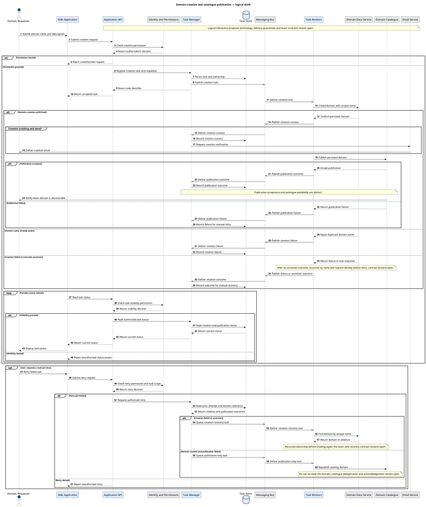

# Domain Task System — Example Architecture

This completed example captures the workshop decisions and explicitly marks the proposed decomposition. It is a format example, not a new approval of the draft design.

## Metadata

| Field | Value |
|---|---|
| Format version | 1 |
| System ID | system |
| Title | Domain Task System |
| Document status | draft |
| Language | en |
| Mode | logical |

## Purpose and scope

Authorized users submit business-domain creation tasks containing a unique name and a description. Workers create domains through an existing external data access layer and then publish them to an existing catalogue. The application tracks task outcomes and notifies creation success; the catalogue separately notifies availability. Creation and publication failures are manually retried. A publication retry must not recreate the domain.

## Sources

| ID | Reference | Locator |
|---|---|---|
| src_interview | User architecture workshop | Confirmed requirements: scope, permissions, persistence, publication, retries and notifications |
| src_proposal | Workshop logical design proposal | Provisional C2 boundaries, C3 components and detailed sequence order |

## Elements

| ID | Name | Type | Parent | Scope | Responsibility | Technology | Deployment | Shape | Status | Sources |
|---|---|---|---|---|---|---|---|---|---|---|
| requester | Domain Requester | Person | - | Actor | Submit domains and follow own tasks | - | - | Person | Confirmed | src_interview |
| operator | Privileged Operator | Person | - | Actor | Inspect and retry others' tasks | - | - | Person | Confirmed | src_interview |
| system | Domain Task System | SoftwareSystem | - | Internal | Create domains and track publication | - | - | Rectangle | Proposed | src_interview, src_proposal |
| identity | Identity and Permissions | SoftwareSystem | - | External | Provide existing identity and permissions | - | - | Rectangle | Confirmed | src_interview |
| bus | Messaging Bus | SoftwareSystem | - | External | Deliver task and result messages | - | - | Rectangle | Confirmed | src_interview |
| domain | Domain Data Service | SoftwareSystem | - | External | Persist and find domains through an access layer | - | - | Rectangle | Confirmed | src_interview |
| catalogue | Domain Catalogue | SoftwareSystem | - | External | Make domains discoverable and notify availability | - | - | Rectangle | Confirmed | src_interview |
| email | Email Service | SoftwareSystem | - | External | Deliver application notification emails | - | - | Rectangle | Confirmed | src_interview |
| consumers | Consumer Applications | SoftwareSystem | - | External | Discover available business domains | - | - | Rectangle | Confirmed | src_interview |
| ui | Web Application | Container | system | Internal | Submit requests and poll task status | - | - | Rectangle | Proposed | src_interview, src_proposal |
| api | Application API | Container | system | Internal | Authorize requests and expose task operations | - | - | Rectangle | Proposed | src_interview, src_proposal |
| manager | Task Manager | Container | system | Internal | Dispatch tasks and maintain their lifecycle | - | - | Rectangle | Proposed | src_interview, src_proposal |
| workers | Task Workers | Container | system | Internal | Create domains and publish to the catalogue | - | - | Rectangle | Proposed | src_interview, src_proposal |
| taskstore | Task Store | Container | system | Internal | Persist task status, ownership and outcomes | - | - | Database | Proposed | src_interview, src_proposal |
| submission | Task Submission | Component | manager | Internal | Accept creation and manual retry requests | - | - | Rectangle | Proposed | src_interview, src_proposal |
| dispatch | Task Dispatch | Component | manager | Internal | Send executable task messages to the bus | - | - | Rectangle | Proposed | src_interview, src_proposal |
| state | Task State | Component | manager | Internal | Track creation and publication separately | - | - | Rectangle | Proposed | src_interview, src_proposal |
| results | Result Intake | Component | manager | Internal | Consume worker outcomes and update task state | - | - | Rectangle | Proposed | src_interview, src_proposal |
| notify | Creation Notification | Component | manager | Internal | Send email after confirmed domain creation | - | - | Rectangle | Proposed | src_interview, src_proposal |

## Relationships

| ID | Source | Target | Action | Details | Status | Sources |
|---|---|---|---|---|---|---|
| c1_r1 | requester | system | Submit tasks | Logical relationship; message semantics are detailed in seq_create. | Proposed | src_interview, src_proposal |
| c1_r2 | operator | system | Manage others' tasks | Logical relationship; message semantics are detailed in seq_create. | Proposed | src_interview, src_proposal |
| c1_r3 | system | requester | Show task status | Logical relationship; message semantics are detailed in seq_create. | Proposed | src_interview, src_proposal |
| c1_r4 | system | identity | Check permissions | Logical relationship; message semantics are detailed in seq_create. | Proposed | src_interview, src_proposal |
| c1_r5 | system | bus | Exchange task messages | Logical relationship; message semantics are detailed in seq_create. | Proposed | src_interview, src_proposal |
| c1_r6 | system | domain | Manage domains | Logical relationship; message semantics are detailed in seq_create. | Proposed | src_interview, src_proposal |
| c1_r7 | system | catalogue | Publish domain | Logical relationship; message semantics are detailed in seq_create. | Proposed | src_interview, src_proposal |
| c1_r8 | system | email | Send notification | Logical relationship; message semantics are detailed in seq_create. | Proposed | src_interview, src_proposal |
| c1_r9 | email | requester | Deliver creation email | Logical relationship; message semantics are detailed in seq_create. | Proposed | src_interview, src_proposal |
| c1_r10 | catalogue | requester | Notify availability | The catalogue, rather than this application, owns availability notifications. | Proposed | src_interview, src_proposal |
| c1_r11 | consumers | catalogue | Discover domains | Applications discover business domains through the catalogue. | Proposed | src_interview, src_proposal |
| c2_r1 | requester | ui | Submit requests | Logical relationship; message semantics are detailed in seq_create. | Proposed | src_interview, src_proposal |
| c2_r2 | operator | ui | Manage others' tasks | Logical relationship; message semantics are detailed in seq_create. | Proposed | src_interview, src_proposal |
| c2_r3 | ui | api | Submit tasks | Logical relationship; message semantics are detailed in seq_create. | Proposed | src_interview, src_proposal |
| c2_r4 | ui | api | Poll task status | Logical relationship; message semantics are detailed in seq_create. | Proposed | src_interview, src_proposal |
| c2_r5 | api | identity | Check permissions | Logical relationship; message semantics are detailed in seq_create. | Proposed | src_interview, src_proposal |
| c2_r6 | api | manager | Manage tasks | Logical relationship; message semantics are detailed in seq_create. | Proposed | src_interview, src_proposal |
| c2_r7 | manager | taskstore | Persist task state | Logical relationship; message semantics are detailed in seq_create. | Proposed | src_interview, src_proposal |
| c2_r8 | manager | bus | Queue tasks | Logical relationship; message semantics are detailed in seq_create. | Proposed | src_interview, src_proposal |
| c2_r9 | bus | workers | Deliver tasks | Logical relationship; message semantics are detailed in seq_create. | Proposed | src_interview, src_proposal |
| c2_r10 | workers | bus | Report results | Logical relationship; message semantics are detailed in seq_create. | Proposed | src_interview, src_proposal |
| c2_r11 | bus | manager | Deliver results | Logical relationship; message semantics are detailed in seq_create. | Proposed | src_interview, src_proposal |
| c2_r12 | workers | domain | Manage domains | Create or reconcile a domain through the external access layer; no direct database access. | Proposed | src_interview, src_proposal |
| c2_r13 | workers | catalogue | Publish domain | Publication follows confirmed creation; acceptance is distinct from discoverability. | Proposed | src_interview, src_proposal |
| c2_r14 | manager | email | Send notification | Proposed responsibility: the Task Manager sends email after receiving creation success. | Proposed | src_interview, src_proposal |
| c3_r1 | api | submission | Submit authorized request | Logical relationship; message semantics are detailed in seq_create. | Proposed | src_interview, src_proposal |
| c3_r2 | api | state | Read authorized status | Logical relationship; message semantics are detailed in seq_create. | Proposed | src_interview, src_proposal |
| c3_r3 | submission | state | Register task attempt | Logical relationship; message semantics are detailed in seq_create. | Proposed | src_interview, src_proposal |
| c3_r4 | submission | dispatch | Dispatch task | Logical relationship; message semantics are detailed in seq_create. | Proposed | src_interview, src_proposal |
| c3_r5 | dispatch | bus | Publish task message | Logical relationship; message semantics are detailed in seq_create. | Proposed | src_interview, src_proposal |
| c3_r6 | bus | results | Deliver worker outcome | Logical relationship; message semantics are detailed in seq_create. | Proposed | src_interview, src_proposal |
| c3_r7 | results | state | Update task outcome | Logical relationship; message semantics are detailed in seq_create. | Proposed | src_interview, src_proposal |
| c3_r8 | state | taskstore | Persist lifecycle state | Logical relationship; message semantics are detailed in seq_create. | Proposed | src_interview, src_proposal |
| c3_r9 | results | notify | Signal creation success | Logical relationship; message semantics are detailed in seq_create. | Proposed | src_interview, src_proposal |
| c3_r10 | notify | email | Send creation email | Logical relationship; message semantics are detailed in seq_create. | Proposed | src_interview, src_proposal |

## Views

| ID | Level | Title | Focus | Elements | Relationships | Status |
|---|---|---|---|---|---|---|
| c1 | C1 | C1 — Domain Task System — Logical Draft | system | requester, operator, system, identity, bus, domain, catalogue, email, consumers | c1_r1, c1_r2, c1_r3, c1_r4, c1_r5, c1_r6, c1_r7, c1_r8, c1_r9, c1_r10, c1_r11 | Proposed |
| c2 | C2 | C2 — Containers — Logical Draft | system | requester, operator, ui, api, manager, workers, taskstore, identity, bus, domain, catalogue, email | c2_r1, c2_r2, c2_r3, c2_r4, c2_r5, c2_r6, c2_r7, c2_r8, c2_r9, c2_r10, c2_r11, c2_r12, c2_r13, c2_r14 | Proposed |
| c3 | C3 | C3 — Task Manager Components — Proposed Logical Draft | manager | api, submission, dispatch, state, results, notify, taskstore, bus, email | c3_r1, c3_r2, c3_r3, c3_r4, c3_r5, c3_r6, c3_r7, c3_r8, c3_r9, c3_r10 | Proposed |

## Constraints

| ID | Rule | Status | Sources |
|---|---|---|---|
| rule_unique | Domain names must be unique. | Confirmed | src_interview |
| rule_permissions | Existing identity and permission services control creation, visibility and retry; selected roles can inspect and retry other users' tasks. | Confirmed | src_interview |
| rule_direct | Authorized users submit directly without a separate approval step. | Confirmed | src_interview |
| rule_creation | Creation succeeds upon confirmed domain persistence through the external access layer. | Confirmed | src_interview |
| rule_publish | Workers automatically publish persisted domains to the existing catalogue. | Confirmed | src_interview |
| rule_retry | Creation and publication failures require manual retry; publication-only retry does not recreate the domain. | Confirmed | src_interview |
| rule_notifications | The application notifies creation success by email and polled web status; the catalogue notifies domain availability. | Confirmed | src_interview |
| rule_manager | Task Manager dispatches work and tracks status without workflow orchestration. | Confirmed | src_interview |
| rule_store | Task tracking uses application-owned storage; domain records are stored by the external service. | Confirmed | src_interview |

## Open questions

| ID | Question | Affects |
|---|---|---|
| q_permissions | What are the exact role and permission names? | api, identity |
| q_recovery | Can the external data service prove that an existing domain belongs to the same creation request after a lost response? | domain, workers, seq_create |
| q_unique | How does the external service enforce atomic uniqueness, including case normalization? | domain, workers |
| q_catalogue | What acknowledgement and deduplication guarantees does the catalogue provide? | catalogue, workers, seq_create |
| q_delivery | What are the bus acknowledgement, deduplication and failed-delivery rules? | bus, manager, workers |
| q_status | What are the precise state transitions and permitted retry conditions? | manager, taskstore |
| q_email | How are email failures and repeated creation notifications handled? | manager, email |
| q_boundaries | Should Application API and Task Manager be separate deployment containers? | c2, c3 |
| q_technology | Which technology and deployment choices should later enrich these logical views? | c2, c3 |

## Sequence: seq_create

| Field | Value |
|---|---|
| Title | Domain creation and catalogue publication — logical draft |
| Participants | requester, ui, api, identity, manager, taskstore, bus, workers, domain, catalogue, email |
| Status | Proposed |
| Sources | src_interview, src_proposal |

## Review notes

The sequence is a logical proposal, not a delivery or reliability guarantee. Polling may occur while workers execute; the drawing groups it for readability. Catalogue availability has independent timing. A lost response is represented as uncertain outcome, not a guaranteed literal error reply. The retry section intentionally leaves the external recovery contract open rather than inventing it.
